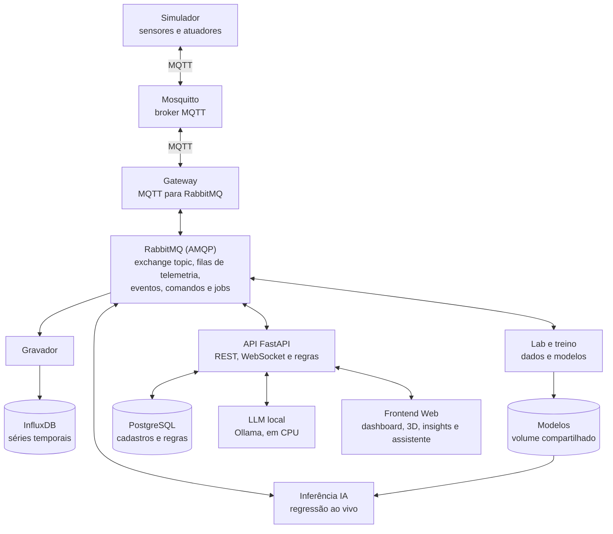

# eyeWatcher

Monitoramento AIoT de salas de servidores: sensores, atuadores, gêmeo digital 3D,
manutenção preditiva e um assistente com LLM local, tudo subindo com um comando.

## O problema

Servidor caseiro, de laboratório ou de empresa pequena quase nunca fica numa sala
com climatização monitorada. O resultado é sempre o mesmo: a temperatura sobe
devagar, o processador reduz a frequência e em algum momento alguma coisa desliga
sozinha. Só aí alguém percebe que tinha um problema, e não sobra nenhum registro.

No 1º bimestre o eyeWatcher resolveu a parte de medir e guardar o histórico. Agora
ele também olha para quem causa o problema: os **ar-condicionados de precisão
(CRACs)** da sala. Eles se desgastam aos poucos, e a IA percebe isso pela vibração,
pela corrente, pela temperatura e pela rotação antes de a máquina parar e a sala
esquentar.

Tem mais detalhe em [docs/PROBLEMA.md](docs/PROBLEMA.md).

## Arquitetura



Todo dado passa pelo RabbitMQ. O detalhe de cada fluxo está em
[docs/ARQUITETURA.md](docs/ARQUITETURA.md).

## Rodando

Precisa só do Docker com Compose. No Windows, a virtualização precisa estar ligada
na BIOS e o WSL2 com pelo menos 8 GB de memória.

```bash
docker compose up
```

Não tem nenhum passo antes disso. O serviço `bootstrap` gera todas as senhas em
`secrets/`, que fica fora do Git. A primeira subida demora mais, porque compila as
imagens e baixa o modelo do Ollama (cerca de 2 GB).

A aplicação fica em **http://localhost:8080**.

### Usuários de demonstração

| Usuário | Papel | O que pode |
|---|---|---|
| `visualizador` | Visualizador | Só vê |
| `operador` | Operador | Comanda atuadores e o simulador |
| `administrador` | Administrador | Também gera dados, treina modelos, cadastra dispositivos e vê a auditoria |

As senhas são geradas na primeira subida e ficam em `secrets/CREDENCIAIS.txt`.

## O que tem em cada página

| Página | O que faz |
|---|---|
| Dashboard | Leituras ao vivo, histórico, estatísticas, atuadores e alertas |
| Gêmeo digital | Sala em 3D movida só pelos dados do WebSocket |
| Insights | Saúde, vida útil restante, tendência, alertas e injeção de falha |
| Assistente | Chat com o LLM local sobre os dados da solução |
| Laboratório de dados | Geração configurável de dados sintéticos |
| Treinamento | Dispara o treino e mostra métricas, base simples e importância dos atributos |
| Dispositivos e regras | Cadastro de dispositivos e regras automáticas |
| Mensageria | Filas, taxas, consumidores, últimas mensagens e DLQ, ao vivo |
| Auditoria | Logins, comandos, jobs e perguntas ao assistente |
| Serviços | Links das interfaces do RabbitMQ, do InfluxDB e do PostgreSQL |

## Sensores, atuadores e equipamentos

| Tipo | Dispositivos |
|---|---|
| Sensores | Temperatura dos racks 01 e 02, umidade, luminosidade, corrente do rack, presença |
| Atuador por regra | Exaustor (liga em 35 °C, desliga em 31 °C), sirene (liga em 38 °C) |
| Atuador pela Web | Iluminação, e os dois CRACs |
| Equipamento monitorado | `crac-01` e `crac-02`: vibração, corrente, temperatura e rotação |

Os atuadores mudam a física da sala. Desligar os CRACs esquenta o ambiente, o que
aciona o exaustor pela regra. Ligar a luz sobe a luminosidade medida.

## O relógio simulado

Cada leitura sai a cada 2 segundos e representa **10 minutos** da vida da sala. Um
dia passa em cerca de 5 minutos, e uma falha de dias acontece durante a
apresentação. As horas de vida útil mostradas são horas simuladas.

## Como rodar cada parte da demonstração

O roteiro completo, na ordem da apresentação, está em
[docs/APRESENTACAO.md](docs/APRESENTACAO.md). Em resumo:

1. **Web para IoT:** no Dashboard, ligue a iluminação e veja a luminosidade subir.
2. **Regra automática:** desligue os dois CRACs. Em cerca de 30 segundos a
   temperatura passa de 35 °C e o exaustor liga sozinho.
3. **Consumidor parado:** rode `docker compose stop recorder` e olhe a fila
   `q.telemetry.influx` crescer na Mensageria. Com `docker compose start recorder`
   ela esvazia, e nenhum ponto se perde.
4. **DLQ:** na Mensageria, clique em "Publicar mensagem inválida".
5. **IA:** gere dados no Laboratório, treine em Treinamento e injete uma falha em
   Insights. A saúde cai em cerca de 1 minuto, e a cena 3D acompanha.
6. **Assistente:** pergunte "qual equipamento está com a pior saúde?".

## Tecnologias

| Camada | O que usamos |
|---|---|
| Frontend | Vue 3, TypeScript, Vite, Pinia |
| Gráficos | Chart.js |
| 3D | Three.js |
| Backend | Python, FastAPI, WebSocket |
| IoT | MQTT com Mosquitto, dispositivo simulado em Python |
| Mensageria | RabbitMQ |
| IA | scikit-learn (regressão com gradient boosting), numpy e pandas |
| LLM local | Ollama com `llama3.2:3b`, em CPU |
| Bancos | PostgreSQL e InfluxDB 2.x |
| Infra | Docker e Docker Compose |

## Organização das pastas

```
eyeWatcher/
├── docker-compose.yml   a solução inteira
├── backend/             todos os serviços Python, uma imagem só
│   ├── eyewatcher/
│   │   ├── api/         FastAPI, auth, regras, assistente
│   │   ├── services/    simulador, gateway, gravador, inferência, lab, treino
│   │   ├── physics.py   física da sala, usada pelo gerador e pelo simulador
│   │   └── features.py  features, usadas pelo treino e pela inferência
│   └── tests/
├── frontend/            Vue, cena 3D e nginx
├── infra/               Mosquitto, RabbitMQ e o gerador de segredos
├── firmware/            ESP32 do 1º bimestre, mantido como histórico
└── docs/                documentação do projeto
```

## Portas

| Porta | Serviço | Acesso |
|---|---|---|
| 8080 | Aplicação | Publicada |
| 15672 | RabbitMQ | Só 127.0.0.1 |
| 8086 | InfluxDB | Só 127.0.0.1 |
| 8081 | Adminer (PostgreSQL) | Só 127.0.0.1 |

## Testes

```bash
cd backend
pip install -r requirements.txt pytest
pytest
```

## Zerar tudo

Apaga os dados, os modelos treinados e o modelo do Ollama:

```bash
docker compose down -v
```

## Documentação

- [docs/PROBLEMA.md](docs/PROBLEMA.md): o problema e a proposta
- [docs/ARQUITETURA.md](docs/ARQUITETURA.md): fluxos e decisões técnicas
- [docs/CONTRACT.md](docs/CONTRACT.md): tópicos, filas, mensagens e rotas
- [docs/APRESENTACAO.md](docs/APRESENTACAO.md): roteiro da apresentação

## Autores

| Nome | GitHub |
|---|---|
| Eduardo Miranda | [@dudumiranda3105](https://github.com/dudumiranda3105) |
| Eduarda Roberta Borges da Silva | [@Eduarda-Borges-Silva](https://github.com/Eduarda-Borges-Silva) |
| Rebeca Souza Lúcio Chagas | [@RebecaSLChagas](https://github.com/RebecaSLChagas) |
| Edson Gabriel Klippel Pereira | - |
