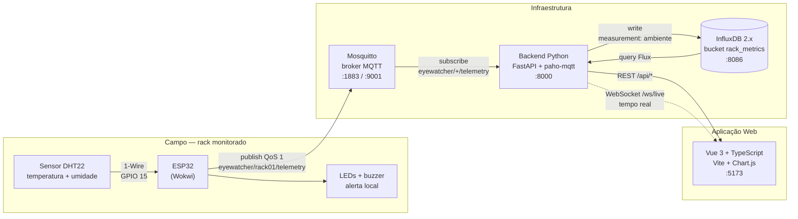
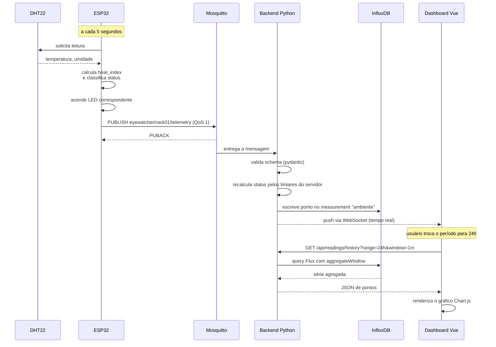
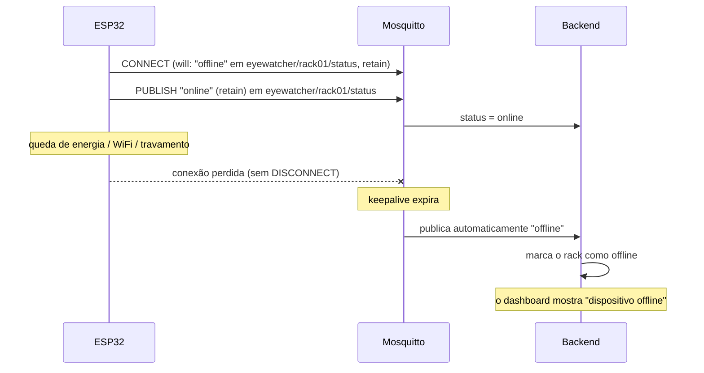

# Arquitetura do eyeWatcher

## 1. Visão geral do fluxo

## 2. Por que cada tecnologia está aqui

| Camada | Tecnologia | Papel concreto no projeto |
|---|---|---|
| Sensor | DHT22 | Mede temperatura (−40 a 80 °C, ±0,5 °C) e umidade (0–100 %, ±2 %) |
| Dispositivo | ESP32 (Wokwi) | Lê o sensor, classifica o status, aciona LEDs e publica via MQTT |
| Transporte | MQTT | Protocolo pub/sub leve, com QoS 1 e *Last Will Testament* |
| Broker | Mosquitto | Intermedia as mensagens e desacopla dispositivo de backend |
| Processamento | Python (FastAPI) | Valida o payload, recalcula o status, persiste e expõe a API |
| Persistência | InfluxDB | Série temporal com agregação e retenção nativas |
| Interface | Vue 3 + TS + Vite | Dashboard reativo e tipado |
| Visualização | Chart.js | Gráfico de linha do histórico com linhas de limiar |
| Versionamento | Git + GitHub | Histórico do código |

## 3. Ciclo de vida de uma leitura

## 4. Detecção de queda do dispositivo (LWT)

Isso resolve um ponto sutil: **a ausência de dados também é um alerta**. Sem o
LWT, um sensor que parasse de reportar deixaria o dashboard exibindo para sempre
a última leitura boa, dando a falsa impressão de que está tudo bem.

## 5. Modelo de dados no InfluxDB

Measurement `ambiente`:

| Elemento | Nome | Tipo | Observação |
|---|---|---|---|
| tag | `device_id` | string | `esp32-rack01` |
| tag | `rack_id` | string | `rack01` |
| tag | `location` | string | `Sala de Servidores A` |
| tag | `status` | string | `ok` / `warning` / `critical` |
| field | `temperature` | float | °C |
| field | `humidity` | float | % RH |
| field | `heat_index` | float | °C (sensação térmica) |
| field | `seq` | int | contador, detecta perda de mensagens |
| time | — | ns | carimbado na chegada ao backend |

**Tag ou field?** Tags são indexadas e servem para filtrar/agrupar; fields
guardam os valores medidos. Por isso `status` é tag (queremos filtrar alertas
por ele rapidamente) e as medições são fields. Manter `location` como tag
permite agrupar racks por sala no 2º bimestre sem alterar o schema.

## 6. Decisões de projeto relevantes

**Timestamp gerado pelo backend, não pelo ESP32.** O ESP32 simulado não tem RTC
com bateria; após um reset ele voltaria a 1970. Como a latência da rede local é
de milissegundos e o intervalo de amostragem é de 5 s, carimbar a hora na
chegada é mais confiável e não distorce a série. O campo `seq` permite detectar
mensagens perdidas mesmo sem timestamp de origem.

**Status calculado duas vezes.** O ESP32 calcula para acender o LED
imediatamente (não depende da rede). O backend recalcula antes de gravar, porque
os limiares podem ser ajustados no servidor sem exigir reflash do firmware —
e porque não se deve confiar cegamente no dado que chega do dispositivo.

**Escrita em lote no InfluxDB.** Uma requisição HTTP por leitura desperdiçaria
conexões; o cliente usa *batching*, agrupando pontos antes de enviar.

**WebSocket com fallback para polling.** Se o WebSocket cair (proxy, rede
instável na apresentação), o dashboard volta sozinho a consultar a API a cada
10 s. A tela nunca congela.
