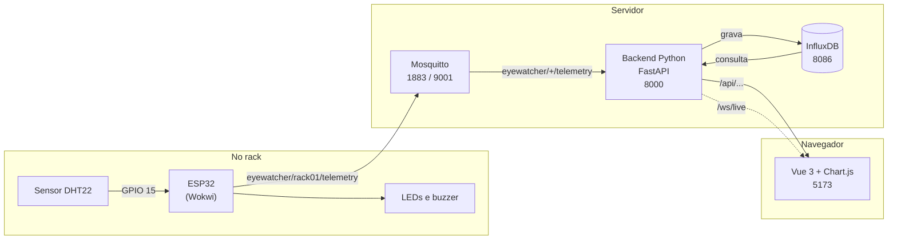
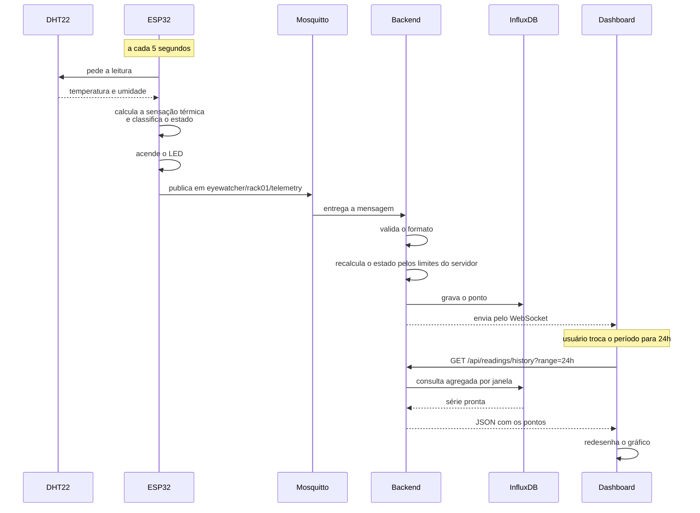
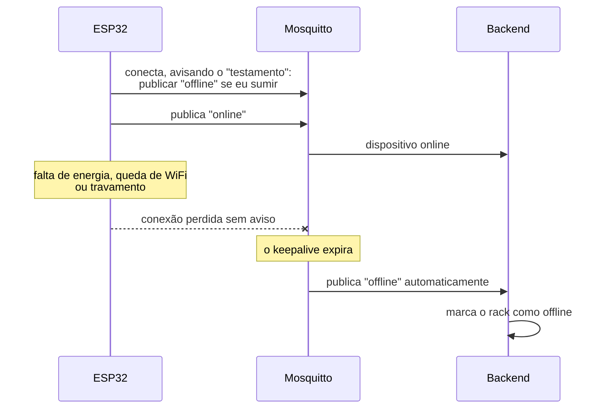

# Arquitetura

## Visão geral

## O papel de cada tecnologia

O DHT22 mede temperatura de -40 a 80 °C com precisão de mais ou menos 0,5 °C, e
umidade de 0 a 100% com precisão de 2%. É barato e suficiente para o que
queremos.

O ESP32 lê o sensor, calcula a sensação térmica, decide se o estado é normal,
alerta ou crítico, acende o LED correspondente e publica a leitura.

O MQTT transporta essas mensagens. O Mosquitto é o broker, ou seja, quem recebe
de quem publica e entrega para quem assina.

O backend em Python recebe as mensagens, valida o conteúdo, recalcula a
classificação e grava. Também é ele que expõe a API que o dashboard consome.

O InfluxDB guarda a série temporal. O Vue 3 com TypeScript monta a interface e o
Chart.js desenha o gráfico.

## O caminho de uma leitura

## Detectando que o dispositivo caiu

Esse recurso do MQTT se chama Last Will and Testament. Quando o cliente conecta,
ele já entrega ao broker uma mensagem que deve ser publicada caso a conexão caia
de forma anormal.

Isso resolve um detalhe que passa despercebido: sem esse mecanismo, um sensor que
parasse de responder deixaria o dashboard mostrando para sempre a última leitura
boa, passando a impressão de que está tudo bem. Com ele, a ausência de dado vira
um aviso explícito.

## Como os dados ficam no banco

Os pontos vão para a medição `ambiente`, com esta estrutura:

| Tipo | Nome | Observação |
|---|---|---|
| tag | `device_id` | esp32-rack01 |
| tag | `rack_id` | rack01 |
| tag | `location` | Sala de Servidores A |
| tag | `status` | normal, alerta ou crítico |
| campo | `temperature` | em °C |
| campo | `humidity` | em % |
| campo | `heat_index` | sensação térmica, em °C |
| campo | `seq` | contador de mensagens |

A diferença entre tag e campo importa. Tags são indexadas e servem para filtrar e
agrupar, campos guardam os valores medidos. Por isso o `status` é tag, já que
queremos filtrar rapidamente só os alertas, e as medições são campos. Deixar a
`location` como tag permite agrupar racks por sala mais tarde sem mudar nada.

## Algumas decisões e o motivo delas

**Quem marca a hora é o backend, não o ESP32.** O ESP32 simulado não tem relógio
com bateria, então depois de um reset ele voltaria para 1970. Como a rede local
responde em milissegundos e a leitura é a cada 5 segundos, marcar a hora na
chegada é mais confiável e não distorce nada. O campo `seq` serve para perceber
se alguma mensagem se perdeu no caminho.

**O estado é calculado duas vezes.** O ESP32 calcula para acender o LED na hora,
sem depender da rede. O backend recalcula antes de gravar, porque assim dá para
ajustar os limites no servidor sem regravar o firmware, e porque não é boa ideia
confiar cegamente no que chega do dispositivo.

**A gravação no InfluxDB é em lote.** Abrir uma requisição HTTP por leitura
desperdiçaria conexão à toa, então o cliente junta alguns pontos antes de enviar.

**O WebSocket tem plano B.** Se a conexão cair, por proxy ou rede instável, o
dashboard volta sozinho a consultar a API a cada 10 segundos. A tela não trava.

**A telemetria usa QoS 0 e o Last Will usa QoS 1.** A biblioteca PubSubClient do
ESP32 só implementa QoS 1 na assinatura e no Last Will, e isso funciona bem aqui.
Como a leitura é a cada 5 segundos, uma mensagem perdida é substituída pela
seguinte em poucos segundos e não muda a análise, e o campo `seq` deixa a perda
visível. Já onde a entrega garantida importa de verdade, que é o aviso de queda
do dispositivo, o QoS 1 está em uso.
