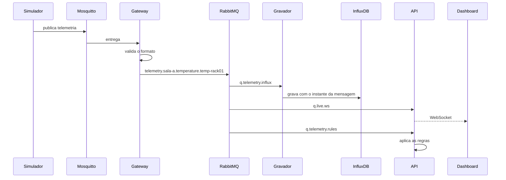
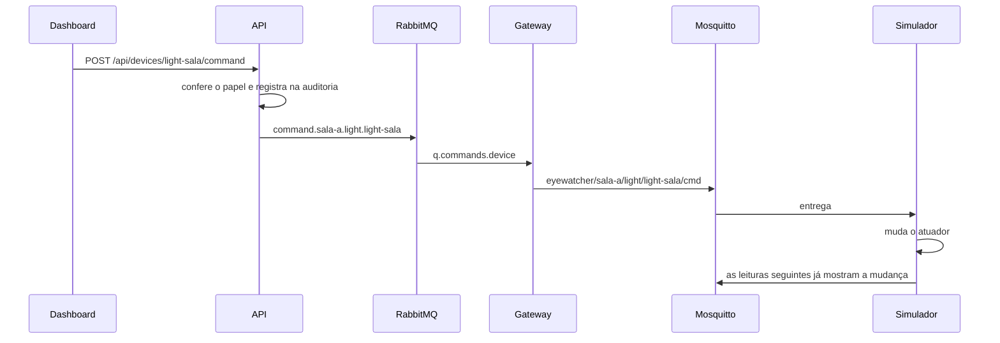
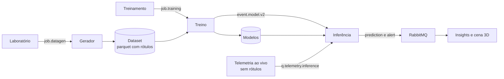

# Arquitetura

## Os dois brokers

O Mosquitto (MQTT) é o protocolo de borda, entre o dispositivo e a aplicação. MQTT
é leve e tem Last Will, que avisa sozinho quando o dispositivo cai.

O RabbitMQ (AMQP) é o barramento interno. Um gateway lê o MQTT e republica no
RabbitMQ, e dali cada serviço consome a sua fila. É ele que dá filas de verdade: se
um serviço parar, as mensagens esperam em vez de se perder.

## Fluxo 1: IoT para Web

## Fluxo 2: Web para IoT

## Fluxo 3: IA

## Filas

| Fila | Consumidor | O que recebe |
|---|---|---|
| `q.telemetry.influx` | Gravador | Telemetria e previsões |
| `q.telemetry.inference` | Inferência | Telemetria dos equipamentos |
| `q.telemetry.rules` | API | Telemetria, para as regras |
| `q.live.ws` | API | Tudo que vai para o navegador |
| `q.commands.device` | Gateway | Comandos para o dispositivo |
| `q.jobs.datagen` | Lab | Jobs de geração |
| `q.jobs.training` | Treino | Jobs de treino |
| `q.api.persist` | API | Alertas, progresso de jobs e modelos |
| `q.inference.control` | Inferência | Aviso de modelo novo |
| `q.dlq` | Ninguém | O que falhou, preservado |

## O papel de cada banco

O **InfluxDB** guarda o que chega o tempo todo e é consultado por intervalo:
leituras e previsões. O bucket `telemetry` tem os dados ao vivo, e o bucket `lab`
tem a amostra dos dados sintéticos, sem misturar.

O **PostgreSQL** guarda o que tem relação e muda pouco: usuários, dispositivos,
regras, alertas, jobs, versões dos modelos e auditoria. Só a API escreve nele.

## Decisões e o motivo delas

**Um relógio simulado.** Uma leitura vale 10 minutos da vida da máquina. As janelas
das features contam leituras, não segundos, então a mesma janela serve para os
dados sintéticos e para o ao vivo. Sem isso, o modelo treinaria num mundo e
trabalharia em outro.

**Uma física só.** `physics.py` é usado pelo gerador e pelo simulador. O mesmo vale
para `features.py`, usado pelo treino e pela inferência. Por isso não há como
divergirem.

**Mais máquinas, menos dias.** Com 40 máquinas por 180 dias, o modelo perdia para a
base simples: ele decorava o jeito de cada máquina em vez de aprender a falha.
Com 150 máquinas por 60 dias ele passou a vencer. Linhas da mesma máquina são quase
iguais, então o que ensina é o número de máquinas, não o de linhas.

**A comparação com a base usa RMSE e R².** Quase toda linha é de máquina saudável, e
a média acerta essas de graça. O MAE sozinho favoreceria a base, que erra justamente
as máquinas que importam. A tela mostra também o resultado só das máquinas
degradando.

**Modelo novo só entra se vencer a base.** Caso contrário a versão fica registrada,
mas a anterior continua em uso.

**Rótulos nunca saem do dataset.** O simulador guarda o desgaste só na memória. A
mensagem leva apenas o que um sensor real mediria, e há um teste que garante isso.

**Histerese nos alertas.** Abrir exige 3 previsões ruins seguidas, e limpar exige 10
boas. As regras também têm dois limites, um para ligar e outro para desligar.

**O gravador usa o instante da mensagem.** Quando ele fica parado e a fila acumula,
cada ponto cai no lugar certo da série ao voltar.

**Permissões mínimas.** Cada serviço tem um usuário no RabbitMQ e só recebe a própria
pasta de segredos. Ninguém além do admin declara filas: a topologia nasce pronta no
`definitions.json`. No Mosquitto, cada usuário só acessa os seus tópicos.

**Reconexão própria ao RabbitMQ.** Se o broker reinicia, cada serviço refaz a conexão
e volta a consumir as mesmas filas, sem reiniciar o container. A reconexão automática
da biblioteca não restaurava os consumidores nesse caso, então o `bus.py` guarda a
lista de filas do serviço e religa todas. Enquanto o broker está fora, quem estava
processando uma mensagem a devolve para a fila em vez de mandá-la para a DLQ.

**O LLM recebe um resumo pronto.** Modelos pequenos erram ao chamar ferramentas,
então a API monta o texto com os dados atuais e o envia junto com a pergunta. O LLM
não acessa nenhum banco.

**WebSocket com ticket.** A URL do WebSocket costuma ir para logs, então o JWT não
aparece nela. O navegador troca o JWT por um ticket de uso único, válido por 30
segundos.
